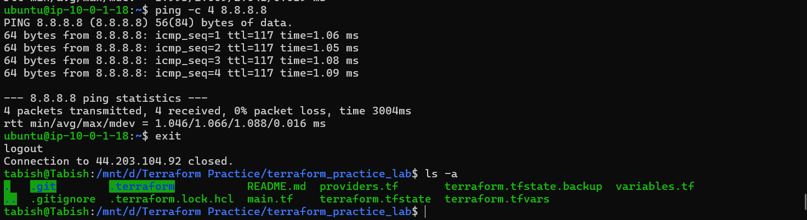

# AWS Network Infrastructure with Terraform

A hands-on Infrastructure as Code (IaC) project that provisions a complete AWS network, from a custom VPC to a Bastion host, using Terraform. The configuration is variable-driven, so CIDR ranges, instance type, key pair, and SSH source IP are all changed from one `terraform.tfvars` file without touching `main.tf`.

---

## Architecture

```


```

**Key idea:** a subnet is "public" or "private" because of its **route table**, not its name. Public subnets route `0.0.0.0/0` to the Internet Gateway; private subnets route it to the NAT Gateway, which allows outbound-only internet access.

---

## What gets created (26 resources)

| Resource | Count | Purpose |
|---|---|---|
| VPC | 1 | Isolated network (`10.0.0.0/16`) |
| Subnets | 6 | 3 public + 3 private (`/24` each) |
| Internet Gateway | 1 | Internet access for public subnets |
| Elastic IP | 1 | Static public IP for the NAT Gateway |
| NAT Gateway | 1 | Outbound internet for private subnets |
| Route tables | 2 | Separate public and private routing |
| Route table associations | 6 | Subnet-to-route-table links |
| Routes | 2 | Default routes via IGW and NAT |
| Security group | 1 | Firewall for the Bastion |
| Security group rules | 3 | SSH (your IP only), HTTP, all outbound |
| Key pair | 1 | Registers your SSH public key in AWS |
| EC2 instance | 1 | Bastion host in a public subnet |

> This lab does not deploy a private EC2 instance. Only the Bastion host is created.

---

## Terraform concepts practised

- Resource blocks and resource references (implicit dependencies)
- Explicit dependency with `depends_on` (NAT Gateway on the IGW)
- Input variables and `variables.tf`
- `map(string)` variable for subnet CIDRs
- `terraform.tfvars` for environment-specific values
- String interpolation for consistent naming (`"${var.project_name}-vpc"`)
- Built-in functions: `file()` and `pathexpand()`
- Output values
- Workflow: `init`, `fmt`, `validate`, `plan`, `apply`, `destroy`

---

## Project structure

```
.
├── providers.tf                # Terraform + AWS provider configuration
├── variables.tf                # Variable declarations
├── terraform.tfvars            # Real values (git-ignored)
├── terraform.tfvars.example    # Safe template to copy
├── main.tf                     # All AWS resources
├── outputs.tf                  # Useful outputs (IPs, IDs)
├── .terraform.lock.hcl         # Provider version lock (committed)
├── .gitignore
└── screenshots/
    └── bastion-internet-connectivity.png
```

---

## Variables

| Variable | Type | Description |
|---|---|---|
| `aws_region` | `string` | AWS region to deploy into |
| `project_name` | `string` | Prefix for all resource names |
| `vpc_cidr` | `string` | VPC CIDR block |
| `subnet_cidrs` | `map(string)` | Subnet name to CIDR block |
| `my_ip` | `string` | Your public IP (without `/32`) allowed to SSH |
| `ami_id` | `string` | Ubuntu AMI ID (region-specific) |
| `instance_type` | `string` | EC2 instance type |
| `key_name` | `string` | Name of the AWS key pair |
| `public_key_path` | `string` | Path to your SSH public key |

Example `subnet_cidrs`:

```hcl
subnet_cidrs = {
  public-1  = "10.0.1.0/24"
  public-2  = "10.0.2.0/24"
  public-3  = "10.0.3.0/24"
  private-1 = "10.0.4.0/24"
  private-2 = "10.0.5.0/24"
  private-3 = "10.0.6.0/24"
}
```

---

## Prerequisites

- An AWS account and an IAM user with permissions for VPC and EC2
- [Terraform](https://developer.hashicorp.com/terraform/install) >= 1.5
- [AWS CLI](https://docs.aws.amazon.com/cli/latest/userguide/getting-started-install.html), configured with `aws configure`
- An SSH key pair:
  ```bash
  ssh-keygen -t ed25519 -f ~/.ssh/terraform-key
  chmod 600 ~/.ssh/terraform-key
  ```
- Developed and tested on **Ubuntu (WSL2)** with VS Code

---

## Usage

```bash
# 1. Clone
git clone https://github.com/<your-username>/<your-repo>.git
cd <your-repo>

# 2. Create your own variable file
cp terraform.tfvars
# Edit it: set my_ip (curl -4 ifconfig.me), ami_id, key_name, public_key_path

# 3. Deploy
terraform init
terraform fmt
terraform validate
terraform plan
terraform apply
```

### Verify

```bash
terraform output
ssh -i ~/.ssh/terraform-key ubuntu@<bastion_public_ip>

# inside the Bastion
ping -c 4 8.8.8.8
ping -c 4 google.com
```

The screenshot below shows successful outbound connectivity from the Bastion to `8.8.8.8`. Run the second ping separately to verify DNS resolution as well.



In the AWS Console, confirm: 6 subnets, public route table to IGW, private route table to NAT, NAT Gateway state `Available`, EC2 status checks `3/3 passed`.

### Clean up

```bash
terraform destroy
```

Then confirm in the console that the NAT Gateway is deleted and the Elastic IP is released.

> **Cost warning:** NAT Gateways and Elastic IPs are billed while they exist, even when idle. Destroy the lab when you are done.

---

## Security notes

- SSH (port 22) is restricted to a single IP (`var.my_ip/32`), never `0.0.0.0/0`.
- `terraform.tfvars`, state files, and private keys are excluded via `.gitignore`.
- Only the public key is uploaded to AWS; the private key never leaves your machine.
- HTTP (port 80) is open to the world in this lab.

---

## Troubleshooting

| Problem | Likely cause |
|---|---|
| `InvalidAMIID.NotFound` | AMI ID does not exist in your chosen region; use an Ubuntu AMI for that region |
| `Permissions 0644 ... too open` | Run `chmod 600` on your private key |
| Destroy hangs on VPC | Resources created manually outside Terraform are still attached |

---

## What I learned

- Terraform builds a dependency graph from resource references, so ordering is handled automatically.
- Variables and `tfvars` separate *structure* from *configuration*, making the same code reusable across environments.
- Public vs private is a routing decision, not a naming one.
- Always read `terraform plan` before `apply`, and always `destroy` lab resources that cost money.

---

## Author

**Muhammad Tabish**
[LinkedIn](https://www.linkedin.com/in/muhammadtabish1/) | [GitHub](https://github.com/tabishmishere)